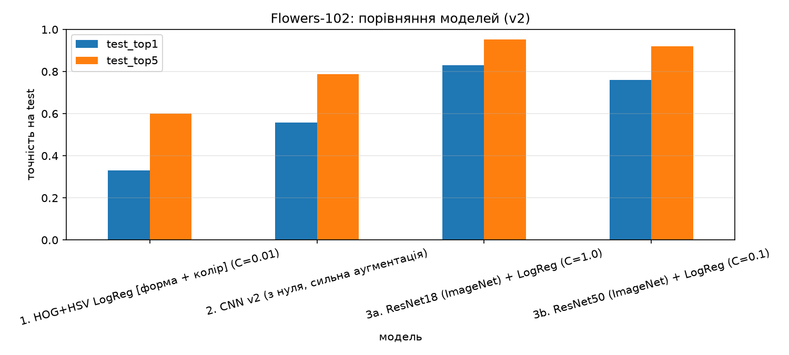
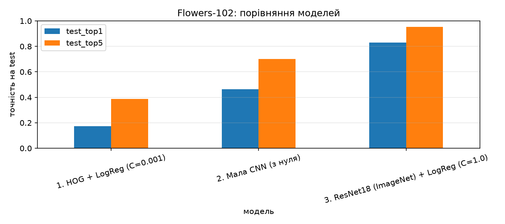
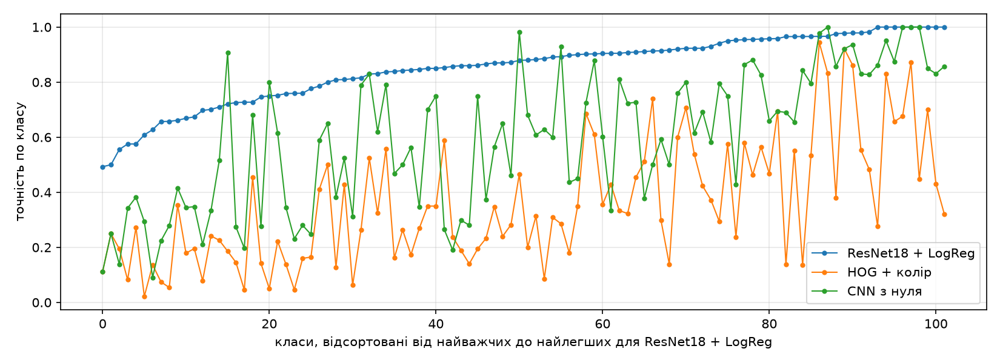
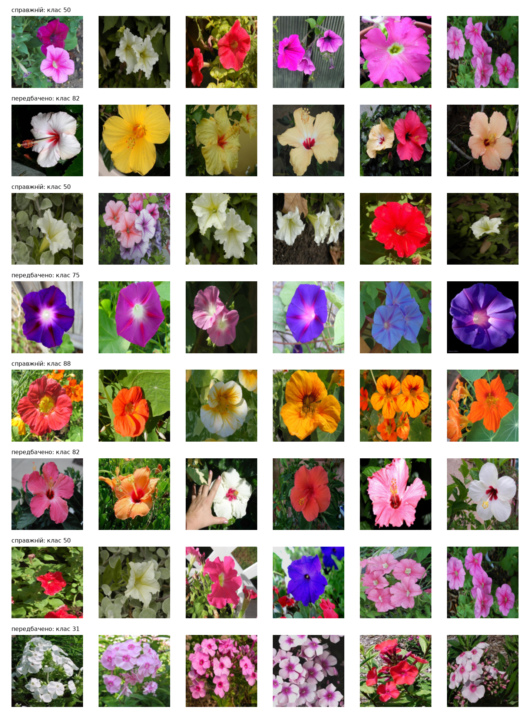

# Flowers-102: порівняння трьох моделей класифікації зображень

Мета проєкту: навчити три моделі різної складності розпізнавати вид квітки за фото (102 види) і порівняти їх.
Найкращий результат: **ResNet18 з transfer learning, 83,1% top-1 і 95,3% top-5** на тесті з 6 149 фото.

## Зміст папки

| Файл / папка | Що це |
|---|---|
| `flowers102_three_models_v1_full.py` | Версія 1: базові три моделі, повний запуск |
| `flowers102_three_models_v2.py` | Версія 2: покращені HOG і CNN, додано ResNet50 |
| `error_analysis.py` | Аналіз помилок на збережених кешах |
| `results_v1.csv`, `results_v2.csv` | Таблиці результатів версій 1 і 2 |
| `comparison_v1_full.png`, `comparison_v2.png` | Графіки порівняння точності |
| `error_per_class.png`, `error_confusions.png`, `error_examples.png` | Графіки аналізу помилок |
| `cnn_best.pt` | Збережені ваги найкращої CNN (версія 2) |
| `cache/`, `data/` | Кеші зображень і ознак та завантажений датасет (великі, можна видалити й відтворити) |
| `flowers102_three_models.py`, `results.csv`, `comparison.png` | Старий «швидкий» запуск, див. [додаток](#додаток-швидкий-запуск-не-для-порівняння) |

## Дані

Oxford 102 Flowers (Flowers-102): 8 189 фото, 102 види. Офіційний поділ: **train 1 020** (по 10 фото на клас), **val 1 020**, **test 6 149** (від 20 до 238 фото на клас). Завантажується автоматично через `torchvision.datasets.Flowers102`.

## Моделі

1. **Проста: HOG + колір + логістична регресія.** Форма описується гістограмою орієнтованих градієнтів (HOG), колір гістограмою кольору. У версії 2 колір описується відтінком і насиченістю (HSV) плюс середнім кольором у сітці 4×4.
2. **Середня: CNN з нуля.** Чотири блоки Conv, BatchNorm, ReLU, MaxPool; вхід 112×112; AdamW. Версія 1: 50 епох, обрізання й віддзеркалення. Версія 2: ширша мережа (48–384 канали), 120 епох, аугментація з поворотом, зміною яскравості й кольору.
3. **Складна: ResNet18 з transfer learning.** Мережа, попередньо навчена на ImageNet, заморожена. З неї береться 512 ознак на фото, на яких навчається логістична регресія. Додатково у версії 2 перевірено ResNet50.

Схема оцінювання однакова для всіх: навчання на **train**, вибір параметрів (C, найкраща епоха) за **val**, **test** рахується один раз наприкінці. Метрики: top-1 (правильний клас найімовірніший) і top-5 (правильний клас серед п'яти найімовірніших).

## Як запустити

```bash
python3 -m venv venv
source venv/bin/activate
pip install torch torchvision scikit-learn scikit-image scipy pandas matplotlib jupyter
python flowers102_three_models_v1_full.py   # версія 1 (результати версії 1)
python flowers102_three_models_v2.py        # версія 2 (results_v2.csv, cnn_best.pt)
python error_analysis.py                    # аналіз помилок, потребує кешів з попередніх запусків
```

Скрипти розбито на комірки `# %%`, їх зручно запускати по черзі у VS Code. У файлах є перемикач `QUICK`: `True` дає скорочений запуск для перевірки (мало епох і лише 600 тестових фото), для справжніх результатів потрібно `False`. Перший запуск довший: завантажується датасет, а ознаки ResNet кешуються.

Експерименти виконано на MacBook Air M2 (8 ГБ), PyTorch з GPU `mps`.

## Результати

### Версія 2 (основна), test = 6 149 фото

| Модель | val top-1 | test top-1 | test top-5 | Час, с |
|---|---|---|---|---|
| 1. HOG + колір (HSV) + LogReg | 37,3% | 33,0% | 60,0% | 31 |
| 2. CNN з нуля, 120 епох | 61,3% | 55,9% | 78,7% | 492 |
| 3a. ResNet18 + LogReg | 85,1% | **83,1%** | **95,3%** | 90 |
| 3b. ResNet50 + LogReg (додатково) | 77,4% | 76,0% | 92,1% | 192 |



### Версія 1 (повний запуск), test = 6 149 фото

| Модель | val top-1 | test top-1 | test top-5 | Час, с |
|---|---|---|---|---|
| 1. HOG + колір (RGB) + LogReg | 20,3% | 17,4% | 38,6% | 14 |
| 2. CNN з нуля, 50 епох | 50,1% | 46,4% | 70,2% | 207 |
| 3. ResNet18 + LogReg | 85,1% | 83,1% | 95,3% | 0,5\* |

\* Ознаки ResNet18 уже були в кеші, тому час містить лише навчання класифікатора. Витяг ознак додатково займає близько 44 с (5,7 + 5,5 + 33,0).



### Що змінилося між версіями (test top-1)

| Модель | Версія 1 | Версія 2 | Зміна |
|---|---|---|---|
| HOG + колір | 17,4% | 33,0% | +15,6 п.п. |
| CNN з нуля | 46,4% | 55,9% | +9,5 п.п. |
| ResNet18 + LogReg | 83,1% | 83,1% | 0 (модель не змінювалась) |

Змін у моделях було кілька, і їхній окремий внесок не вимірювався. Для HOG це HSV, сітка кольорів і ширший підбір параметра C. Для CNN це сильніша аугментація, ширша мережа і більше епох.

### Додаток: «швидкий» запуск (не для порівняння)

Перший прогін скрипта відбувся в режимі `QUICK = True`: CNN вчилася лише 3 епохи, а test складався з перших 600 фото. Результати: HOG 28,0%, CNN 17,2%, ResNet18 86,0% (top-1). Вони **не порівнювані** з таблицями вище, бо тестова вибірка інша й менша (на 600 фото стандартна похибка оцінки близько 1,5–2 п.п.), тому в аналізі їх не використовуємо.

## Аналіз результатів

1. **Transfer learning виграє з великим відривом.** ResNet18 дає 83,1%: на 27 п.п. більше, ніж CNN з нуля (55,9%), і на 50 п.п. більше, ніж HOG + колір (33,0%). З десятьма фото на клас нейромережа з нуля не має достатньо прикладів, а ResNet використовує знання, отримані на мільйонах зображень ImageNet.
2. **Top-5 показує, наскільки модель «близько».** Різниця між top-5 і top-1: ResNet18 12,3 п.п., CNN 22,8 п.п., HOG 27,0 п.п. Слабші моделі частіше мають правильний клас у п'ятірці найімовірніших, але не на першому місці: вони розрізняють групи схожих видів, проте не одиничні види.
3. **Val і test близькі, але test завжди нижчий.** Різниця val − test: ResNet18 2,0 п.п., HOG 4,3 п.п., CNN 5,4 п.п. У CNN вона найбільша, бо найкращу з 120 епох ми вибирали саме за val, тому val-оцінка трохи оптимістична. Чесною оцінкою є test.
4. **Покращення простих моделей суттєві.** HOG зріс з 17,4% до 33,0%, CNN з 46,4% до 55,9%. Але навіть покращені, вони далеко від ResNet18.
5. **Час і точність.** HOG найшвидший (31 с), але найслабший. CNN навчалась найдовше (близько 8 хв), проте точність нижча, ніж у ResNet18, якому разом із витягом ознак потрібно 90 с. На малому датасеті готові ознаки вигідніші за навчання з нуля і за часом, і за точністю.
6. **ResNet50 вийшов гіршим за ResNet18** (76,0% проти 83,1%), хоч мережа більша. Це не перевірено, але можлива причина: 2 048 ознак при 1 020 навчальних фото призводять до перенавчання класифікатора, а ваги ResNet50 за замовчуванням у torchvision відрізняються від ResNet18 і можуть гірше підходити для простого лінійного класифікатора. Перевірити це можна, взявши іншу версію ваг.

## Аналіз помилок

Результати отримано скриптом `error_analysis.py` (HOG + колір, ResNet18 і CNN на тестових фото).



- **Помилки розкидані.** ResNet18 безпомилково розпізнає 9 із 102 класів, найважчі класи мають 49–60% точності, без одного «катастрофічного» виду.
- **Важкі класи спільні для моделей.** Кореляція точності по класах між HOG і ResNet18 дорівнює 0,61, тобто складність пов'язана зі самими квітами, а не з однією моделлю.
- **Що з чим плутають.** Найчастіша помилка ResNet18: клас 50 приймається за клас 82 (22 випадки, 9,2% класу); далі клас 50 → 75 (10), клас 88 → 82 (9). Для HOG найчастіша помилка зовсім інша: клас 76 → 9 (42 випадки, 18,2%). На прикладах із `error_confusions.png` видно, що це візуально схожі квітки (подібна форма й колір), а різні фони й освітлення ще посилюють плутанину. Назви класів у torchvision не зберігаються, тому в аналізі використано номери.
- **CNN з нуля працює нерівно.** Для одних класів вона має 90–98% точності, для інших лише 10–20%. Вона засвоїла «легкі» й характерні види, а на схожих між собою помиляється. ResNet18 стабільніша по всіх класах.
- **Нерівний тест.** У test від 20 до 238 фото на клас, а у train по 10. Тому загальна точність ResNet18 (83,1%) нижча за середню по класах (85,1%): великі й важкі класи, як клас 50 (238 фото), тягнуть загальну цифру вниз. Для HOG так само: 33,0% загальна проти 35,9% середня по класах.



## Порівняння з літературою

| Метод | Рік | Точність |
|---|---|---|
| HSV + SIFT + HOG, multiple kernel learning (оригінальна стаття датасету) | 2008 | 72,8% |
| OverFeat + лінійний SVM (Razavian та ін.) | 2014 | 74,7% |
| OverFeat + SVM з аугментацією (Razavian та ін.) | 2014 | 86,8% |
| DINOv2 ViT-B/14, лінійний класифікатор на заморожених ознаках (Oquab та ін.) | 2024 | 89,6% |
| DINOv2 ViT-g/14, лінійний класифікатор (Oquab та ін.) | 2024 | 91,6% |
| **Наша ResNet18 + LogReg** | 2026 | **83,1%** |
| **Наш HOG + колір + LogReg** | 2026 | **33,0%** |

Наш ResNet18 вищий за OverFeat без аугментації й нижчий за сучасні ознаки DINOv2. HOG + колір істотно слабший за ручний підхід 2008 року, де поєднували чотири типи ознак і складніший класифікатор. Рейтинг [SOTA2](https://www.sota2.com/research/sota/image-classification-on-flowers102-accuracy) показує близько 99,6% для DINOv2 ViT-B/14 з донавчанням LoRA, але це вторинне джерело без звірки з першоджерелами, і протоколи оцінювання в різних роботах можуть відрізнятися, тому прямо порівнювати з нашими цифрами не варто.

## Джерела

1. M.-E. Nilsback, A. Zisserman. *Automated flower classification over a large number of classes*, 2008. [ORA, Oxford](https://ora.ox.ac.uk/objects/uuid:2bfd9528-99c5-41ed-b48e-ad0b46cb995c)
2. A. S. Razavian, H. Azizpour, J. Sullivan, S. Carlsson. *CNN Features off-the-shelf: an Astounding Baseline for Recognition*, 2014. [arXiv:1403.6382](https://arxiv.org/pdf/1403.6382)
3. M. Oquab, T. Darcet, T. Moutakanni та ін. *DINOv2: Learning Robust Visual Features without Supervision*, TMLR, 2024. [arXiv:2304.07193](https://arxiv.org/pdf/2304.07193)
4. SOTA2: Image Classification on Flowers102 (вторинне джерело). [sota2.com](https://www.sota2.com/research/sota/image-classification-on-flowers102-accuracy)
5. Flowers102 у torchvision: [документація](https://docs.pytorch.org/vision/stable/%5Fmodules/torchvision/datasets/flowers102.html)
